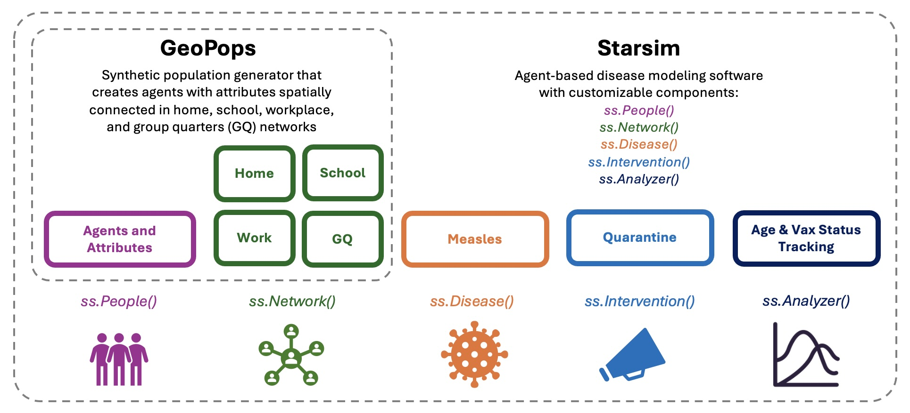

# GeoPops Measles Tutorial

This tutorial demonstrates how to simulate a measles outbreak in Spartanburg County, South Carolina, USA using the synthetic population generator, [GeoPops](https://github.com/GeoPopsHub/geopops), and the agent-based modeling software, [Starsim](https://starsim.org/). The tutorial includes five interactive notebooks in which users: 
1. Make a population with GeoPops
2. Compare the population to real Census data
3. Explore home, school, and workplace networks
4. Run an Starsim ABM with infections seeded to a specific school and observe spatial spread, and
5. Test different quarantine strategies and track outcomes by age group. 

Think of this tutorial and measles example as a starting point of an iterative, community-building modeling exercise. GeoPops and Starsim provide a customizable framework for a detailed, context-specific scenario model, but this version is the first draft! There is still a lot that can be added in collaboration with public health researchers and officials on the ground to make the population and model more realistic. The [GeoPops_Measles.pdf](https://github.com/GeoPopsHub/sc_spartanburg_measles/blob/main/GeoPops_Measles.pdf) provides an overview of the GeoPops with Starsim framework as well as the measles outbreak in South Carolina.

## GeoPops with Starsim

The **GeoPops with Starsim** framework enables detailed scenario modeling because for every agent, we know:
* Several demographic characteristics (age, gender, race/ethnicity, income, and more)
* Where they live and where they go to school or work
* Who infected them, when, and where (home, school, work, GQ)
* When they transition disease compartments (e.g., S, I, R)

Think of the framework like a puzzle. Each puzzle piece is a different model component (e.g., people, networks, disease). By customizing the logic and parameters of each component, you determine the how the puzzle pieces fit together and what picture they make.

All GeoPops and Starsim code is open source, enabling users to customize populations, diseases, and interventions for their own research questions. Our aim is to build capacity of modelers and increase decision-making relevance with context-specific simulations using open-source, user-friendly tools.

Please log issues if you run into bugs or have questions as you go through the notebooks!

